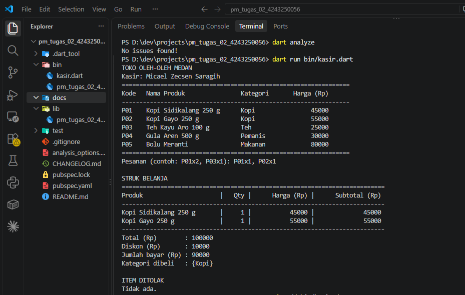
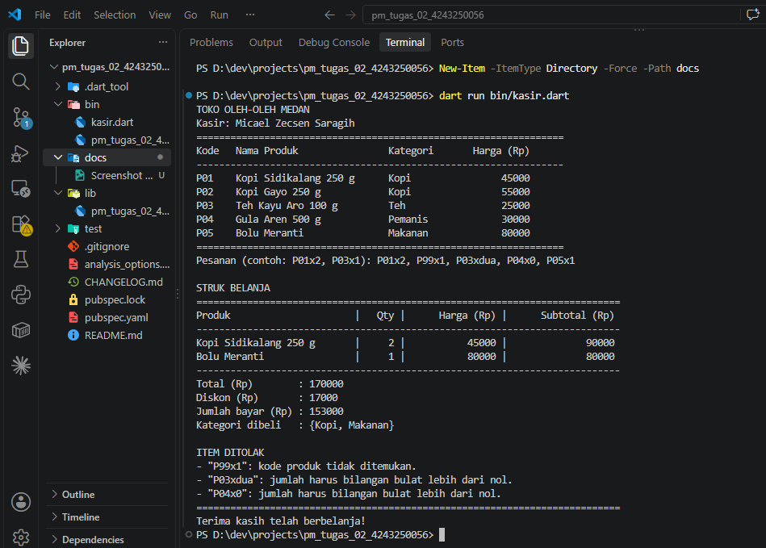

# Tugas Rutin 2 — Aplikasi Console Kasir Sederhana

## Identitas

- Nama: Micael Zecsen Saragih
- NIM: 4243250056
- Kelas: PSIK 24 D
- Mata kuliah: Pemrograman Mobile
- Program studi: Ilmu Komputer, Universitas Negeri Medan

## Deskripsi Program

Program kasir toko oleh-oleh Medan yang dijalankan melalui terminal.
Pengguna memasukkan pesanan dalam satu baris, misalnya:

```text
P01x2, P03x1
```

Program memeriksa setiap item, menghitung belanja, dan mencetak struk.
Item yang tidak valid ditolak dengan alasan yang ditampilkan kepada pengguna.

## Fitur

- Katalog lima produk menggunakan Map dengan nilai berupa Record.
- Tabel katalog dan struk dirapikan dengan padRight dan padLeft.
- Input diolah menggunakan split, trim, dan int.tryParse.
- Pesanan valid disimpan dalam List.
- Subtotal dihitung menggunakan map dan total menggunakan fold.
- Diskon 10% diberikan jika total belanja minimal Rp100.000.
- Kategori produk ditampilkan menggunakan Set agar tidak berulang.
- Input kosong, format salah, kode tidak dikenal, dan jumlah tidak valid ditangani.
- Program tidak menggunakan dynamic atau operator pemaksaan null (!).

## Cara Menjalankan

Pastikan Dart SDK sudah terpasang. Dari folder proyek, jalankan:

```bash
dart pub get
dart run bin/kasir.dart
```

Masukkan kode produk dan jumlah dengan pemisah x.
Pisahkan beberapa item menggunakan koma.

## Bukti Pengujian

### Skenario 1: Pesanan Valid

Input:

```text
P01x1, P02x1
```

Hasil:
- Kopi Sidikalang: Rp45.000.
- Kopi Gayo: Rp55.000.
- Total: Rp100.000.
- Diskon: Rp10.000.
- Jumlah bayar: Rp90.000.
- Kategori: {Kopi}.
- Tidak ada item ditolak.

Pengujian ini menunjukkan bahwa diskon berlaku saat total tepat Rp100.000.



### Skenario 2: Pesanan Mengandung Kesalahan

Input:

```text
P01x2, P99x1, P03xdua, P04x0, P05x1
```

Hasil:
- P01 sebanyak 2 dan P05 sebanyak 1 diterima.
- P99x1 ditolak karena kode produk tidak ditemukan.
- P03xdua ditolak karena jumlah bukan bilangan bulat.
- P04x0 ditolak karena jumlah harus lebih dari nol.
- Total: Rp170.000.
- Diskon: Rp17.000.
- Jumlah bayar: Rp153.000.
- Kategori: {Kopi, Makanan}.

Item yang salah tidak menghalangi pemrosesan item yang valid.



### Pemeriksaan Kode

Perintah:

```bash
dart analyze
```

Hasil:

```text
No issues found!
```

## Penjelasan Variabel dan Null Safety

Dalam Dart, var digunakan untuk mendeklarasikan variabel dengan tipe yang
disimpulkan dari nilai awal. Nilainya dapat diganti selama tetap sesuai
dengan tipe tersebut. Contohnya, var jumlah = 2 dapat diubah menjadi 3,
tetapi tidak menjadi teks. Pada program ini saya lebih banyak menggunakan
final karena nilai setiap variabel tidak perlu ditetapkan ulang.

Final berarti variabel hanya dapat ditetapkan sekali, tetapi nilainya boleh
diperoleh saat program berjalan. Contohnya adalah final input pada baris 41
dan final jumlah pada baris 63. Untuk koleksi final, isinya masih dapat
ditambah; yang tidak boleh dilakukan adalah mengganti referensi variabelnya.

Const digunakan untuk nilai tetap yang dapat diketahui saat kompilasi.
Pada baris 105–106, batasDiskon bernilai 100000 dan persentaseDiskon
bernilai 0.10.

Null safety membantu program menangani data yang mungkin tidak tersedia.
Pada baris 41, operator ?? mengganti hasil input null dengan teks kosong.
Pada baris 63, int.tryParse menghasilkan null jika jumlah tidak dapat
diubah menjadi bilangan bulat. Pencarian katalog pada baris 66 juga dapat
menghasilkan null. Pengecekan pada baris 68 dan 73 menolak item tersebut
sebelum datanya digunakan, sehingga pesanan lain tetap diproses.

## Pernyataan Penggunaan AI

Saya menggunakan ChatGPT untuk membantu memahami materi, menyusun contoh
kode program, memperbaiki saran analyzer, dan menyusun draf README.
Saya menjalankan program serta memeriksa hasil perhitungan dan penolakan
input melalui terminal VS Code.

Konsep yang dipelajari mencakup Map dan Record untuk katalog, List untuk
pesanan, Set untuk kategori unik, serta map dan fold untuk perhitungan.
Saya juga mempelajari penanganan nilai nullable menggunakan ??,
int.tryParse, dan pemeriksaan sebelum data digunakan.